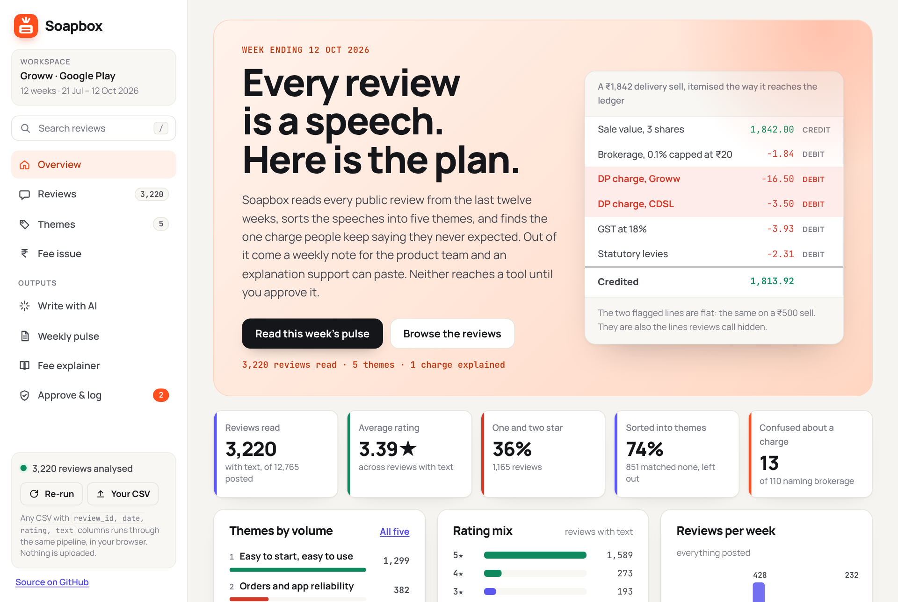
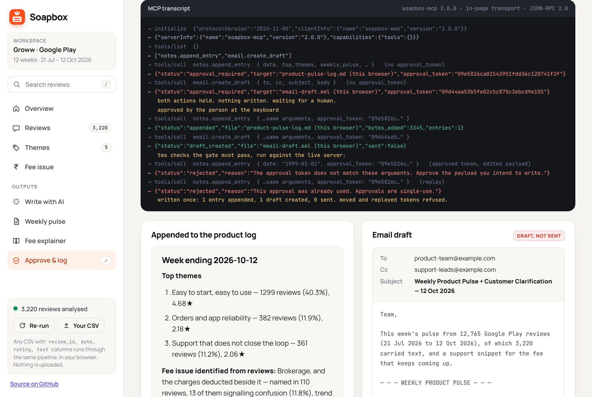
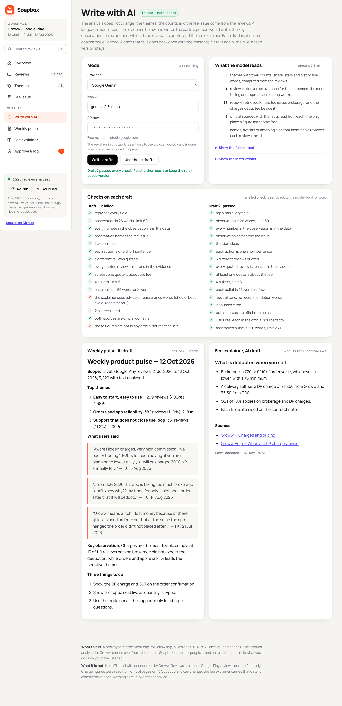

# Soapbox — from app reviews to a weekly pulse, a fee explainer, and an approval gate

**Live prototype:** https://jaytech3.github.io/Soapbox/

Every review is someone on a soapbox. Twelve weeks of public Groww reviews from the Google Play listing go in. Out come two things a real team would use on a Monday: a **weekly product pulse** for the product team, and a **facts-only explanation of the charge users keep misreading** for support to paste. Neither reaches an internal tool until a person approves it — the MCP server refuses both calls the first time and returns what it *would* write, with a single-use token.

The analysis is computed from the reviews. The writing can be done two ways: by rules, which needs nothing, or by a language model you bring a key for, which reads a retrieved evidence pack and has every claim it makes checked against that pack before it can reach the gate ([section 5](#5-where-the-language-model-comes-in)).

Built for the **NextLeap PM Fellowship, Milestone 5 (RAGs & Context Engineering)**. The product is **Groww**, carried forward from Milestone 1 and used in [Milestone 4](https://github.com/jaytech3/pramaan).

| Deliverable | Where |
|---|---|
| Working prototype | https://jaytech3.github.io/Soapbox/ |
| Weekly product pulse | [out/weekly-pulse.md](out/weekly-pulse.md) |
| Doc snippet showing the appended entry | [docs/product-pulse-log.md](docs/product-pulse-log.md) |
| Email draft | [out/email-draft.md](out/email-draft.md), [out/email-draft.eml](out/email-draft.eml) |
| Reviews CSV | [data/reviews.csv](data/reviews.csv) (3,220 rows) |
| Source list | [sources.csv](sources.csv) (6 URLs) |
| Fee explainer | [out/fee-explainer.md](out/fee-explainer.md) |
| Machine-readable payloads | [out/doc-entry.json](out/doc-entry.json), [out/fee-signals.csv](out/fee-signals.csv), [out/themes.csv](out/themes.csv) |
| Screenshots of the prototype | [docs/screenshots/](docs/screenshots/) (overview, reviews, themes, fee issue, pulse, explainer, gate, transcript, log and draft, rejection, phone) |
| AI writer | [src/ai.js](src/ai.js): context pack, instructions, checks, one retry with the failures, fallback to rules |
| Checks | [eval/run_eval.js](eval/run_eval.js) (86, headless) and [eval/browser_check.js](eval/browser_check.js) (56, in Chromium) |

<p align="center">
  
</p>

---

## 1. How to run it, and what to look at

**The prototype.** It analyses the reviews the moment it loads, in the browser, and is laid out as a product: a sidebar with eight views, a search box that jumps straight into the reviews, a workspace card, and a run card with **Re-run** and **Your CSV**. Drop any CSV with `review_id, date, rating, text` columns on that button and the same pipeline runs on it, in the browser; nothing is uploaded anywhere. The views, in the order the brief asks for them:

| View | What it shows |
|---|---|
| **Overview** | The week's headline, five KPI tiles, themes by volume, the rating mix, reviews per week, the charge users keep misreading with one quote, and the run trace. |
| **Reviews** | Every review with text from the window, in one place. Search any word (matches are highlighted), filter by theme or rating, keep only reviews that name a charge, sort by date, helpfulness, rating or length. Four tiles summarise whatever is filtered. Forty at a time, with "show more". |
| **Themes** | Five cards with counts, share, average rating, one-and-two-star share, a twelve-week sparkline and the words that distinguish each theme; a button on each opens the reviews view already filtered. The three verbatim quotes sit below. |
| **Fee issue** | The six charges scored on mentions × confusion rate, the confused mentions by week, and every review behind the score. |
| **Write with AI** | Optional. Pick Gemini, OpenAI or Anthropic and paste your own key; the page shows exactly what the model will read, the checks each draft passes or fails, and both drafts before you choose to use them. Without a key, nothing here runs and the rule-based outputs stay. |
| **Weekly pulse** | The 250-word note, with its word count, copy and download, and a rail of the checks it passes: the limit, the three themes, the three verbatim quotes, the observation, the three actions. |
| **Fee explainer** | The six-bullet support snippet, its two official sources and the "Last checked" date, with its own rail of checks: bullet limit, official domains, neutral tone, every rate traceable to `sources.csv`. |
| **Approve & log** | The two MCP payloads beside a sticky decision card, the live transcript, and after approval the appended log entry and the email draft side by side. |

To run it on your own machine it needs a server, because the page reads the CSV over HTTP; opening `index.html` from disk will not work.

```bash
git clone https://github.com/jaytech3/soapbox.git
cd soapbox
python3 -m http.server 8000     # then open http://localhost:8000
```

**The same pipeline, headless.** Writes every deliverable into `out/`:

```bash
node cli/run.js          # requires Node 18+, no dependencies
node cli/run.js --json   # the whole result object
SOAPBOX_AI_KEY=... node cli/run.js --ai gemini   # also writes AI drafts, the context and every attempt to out/ai/
```

**The MCP server and the approval gate**, over stdio, with the JSON-RPC traffic printed:

```bash
node mcp/client-demo.js            # asks you to approve at the terminal
node mcp/client-demo.js --reject   # shows that nothing is written on a no
node mcp/server.js                 # the server alone, for your own MCP client
```

**The checks.** 86 of them, covering every constraint in the brief plus the gate, run against the live server in a scratch directory so a test run never touches the real log. Twenty-two of them run the AI writer against a stand-in model, with no network: a grounded draft passes, and an invented rupee figure, advice words, a made-up review id, an invented number, an unknown source and a seventh bullet are each caught. A further 56 walk every view of the prototype in headless Chromium, search and filter the reviews, push a CSV through the upload path, write AI drafts with the model call intercepted, approve, and read the document back:

```bash
node eval/run_eval.js            # exit 1 on any failure
node eval/browser_check.js       # needs playwright + chromium; skips cleanly without them
```

---

## 2. Where the MCP approval happens

Two tools are exposed by [`mcp/server.js`](mcp/server.js): `notes.append_entry` (appends to `docs/product-pulse-log.md`) and `email.create_draft` (writes an `.eml` draft, never sends).

Both are gated in the server itself, not in the client, so an agent that forgets to ask cannot write anything:

```
call  notes.append_entry { date, top_themes, weekly_pulse, … }        no token
  →   { "status": "approval_required",
        "what_will_happen": "Append a dated entry to docs/product-pulse-log.md",
        "preview": "## Week ending 2026-10-12 …",
        "approval_token": "3f9c…" }                                   nothing written

      [ a human reads the preview and decides ]

call  notes.append_entry { …same arguments…, approval_token: "3f9c…" }
  →   { "status": "appended", "file": "docs/product-pulse-log.md", "bytes_added": 3364 }
```

Three properties make the gate worth something, and each has a test:

- **The token is an HMAC of the arguments.** An approval obtained for one payload cannot be reused to write a different one. Changing a single field after approval is refused.
- **Approvals are single-use.** A replayed call is refused, so a retry loop cannot append the same entry five times.
- **The secret is minted per process.** Tokens do not survive a restart.

**The browser runs the same server.** GitHub Pages serves static files and cannot host a stdio process, so the tools, the gate and the JSON-RPC handler live in [`src/mcp-core.js`](src/mcp-core.js) with nothing platform-specific inside. `mcp/server.js` wraps that core in stdio, Node's HMAC and the filesystem; `app.js` wraps the same core in an in-page transport, Web Crypto's HMAC and this browser's storage, which stands in for the document and the draft. The Approve & log view prints the exchange as it happens: the two refusals, the computed tokens, the writes after approval, and then two checks the gate has to pass in front of you — the approved token resent with an edited date, and the same token replayed — both refused by the server, not by a line in the page. Reject instead, and the client tries a forged token; the log in your browser stays the size it was. Nothing in the transcript is scripted; [`eval/browser_check.js`](eval/browser_check.js) asserts exactly that.

<p align="center">
  
</p>

The document the page appends to survives a reload and can be downloaded whole; on a machine, the same call appends to `docs/product-pulse-log.md`, which is the file in this repo. The email draft is an `.eml` with `X-Unsent: 1`, so a mail client opens it as an editable draft, and an "Open in Gmail" link fills a compose window. Neither path can send.

---

## 3. What fee issue the reviews identified

**Brokerage, and the charges deducted beside it.** Named in **110** reviews, of which **13** also signal that the deduction was not expected — "hidden charges", "extra charge", "bina bataye", "pata nahi". It wins on a score that multiplies how often a charge is raised by how often it is misread, because raw volume would always pick the best-known charge and raw density would pick one two people mentioned.

| Charge | Named in | Confused | Rate | Score |
|---|--:|--:|--:|--:|
| **Brokerage, and the charges deducted beside it** | 110 | 13 | 11.8% | **1.53** |
| Auto square-off charge | 4 | 2 | 50.0% | 1.00 |
| MTF interest and pledge charges | 18 | 4 | 22.2% | 0.89 |
| Account maintenance and platform fees | 18 | 4 | 22.2% | 0.89 |
| What is deducted when you sell, beyond brokerage | 23 | 3 | 13.0% | 0.39 |
| GST and statutory levies | 4 | 1 | 25.0% | 0.25 |

The verbatims say what the number cannot. One review puts the whole problem in a sentence:

> ये लोग brokrege charge कितना काट ना है वो तो बताएगै लेकिन, DP charge, CDSL DP charge, exchange ट्रांजेक्शन चार्ज कितना कटना है, वो कभी नही बताया जायेगा।
> *(They will tell you how much brokerage will be cut, but how much DP charge, CDSL DP charge and exchange transaction charge will be cut is never told.)* — 1★, 16 Sep 2026

So the problem is not the price. Every figure is published on Groww's pricing page. The problem is **placement**: brokerage is visible before the order, and the DP charge of ₹16.50 plus CDSL's ₹3.50 plus 18% GST is met in the ledger the next day. On a small delivery sell those flat lines are most of the cost, which is why "hidden" is the word users reach for. That is what the explainer answers and what the three action ideas in the pulse address.

---

## 4. The pipeline

`src/engine.js` is one module with no dependencies, and both the web prototype and `cli/run.js` import it unchanged — the page cannot drift from the file the checks run against. The same holds for the MCP side: `src/mcp-core.js` is imported by both `mcp/server.js` and `app.js`.

```
data/reviews.csv  3,220 reviews, 21 Jul – 12 Oct 2026, text only
      │
      ├─ 1  Window        12 weeks to 12 Oct 2026
      ├─ 2  Qualify       25+ characters of text
      ├─ 3  Cluster       5 themes, strongest match wins, no double counting
      ├─ 4  Rank          top 3 by volume
      ├─ 5  Detect        fee entity x confusion marker → the misread charge
      ├─ 6  Quote         3 verbatims: 2 on the fee, 1 on the leading negative theme
      ├─ 7  Pulse         ≤250 words
      └─ 8  Explainer     ≤6 bullets, 2 official links, "Last checked"
      │
      ▼
  buildDocEntry()      → notes.append_entry      ┐ both gated behind approval
  buildEmailDraft()    → email.create_draft      ┘ in src/mcp-core.js
```

By default no model is called. The same CSV always produces the same note, the same quotes and the same fee — there is a determinism test for exactly that. For a weekly artefact that goes to a team and to customers, reproducibility matters, and it means every sentence can be traced to a row. The AI writer in section 5 keeps that property for everything that is counted, and adds a model only where a person would otherwise write.

**Themes found**

| # | Theme | Reviews | Share | Avg |
|---|---|--:|--:|--:|
| 1 | Easy to start, easy to use | 1,299 | 40.3% | 4.68★ |
| 2 | Orders and app reliability | 382 | 11.9% | 2.18★ |
| 3 | Support that does not close the loop | 361 | 11.2% | 2.06★ |
| 4 | Charges users did not expect | 237 | 7.4% | 2.33★ |
| 5 | Money in and money out | 90 | 2.8% | 2.29★ |

851 reviews (26%) match no theme and are left out rather than pushed into the nearest bucket, because a theme table that accounts for everything is a theme table that has stopped meaning anything.

---

## 5. Where the language model comes in

The engine counts; it does not write well. The parts of the two documents a person would normally write are the key observation, the three actions, which three reviews to quote, and the fee explainer. Those are what the AI writer ([`src/ai.js`](src/ai.js)) asks a model for. Everything that is counted (themes, shares, stars, scope, the fee and its confusion rate) stays computed, and the layout and the 250-word limit stay in the engine.

**Retrieval and the context pack.** For each theme the engine retrieves its most telling reviews, scored by the same picker that chooses quotes and spread across the twelve weeks (5 for each top theme, 3 for the others), and 10 for the fee issue. Those go into one labelled pack with the computed stats and the six official sources, each carrying the facts read from it. Reviews are clipped to 60 words and identified by id only. The pack is about 4,700 tokens. The page shows it in full, along with the instructions, before anything is sent.

**Checks, not trust.** A reply is accepted only if it passes every check:

| The model must | Checked by |
|---|---|
| quote 3 different reviews, at least one about the fee | each id must exist in the evidence it was given |
| use no number the data does not contain | every number in the observation is looked up in the pack |
| state only rates that are in an official source | every ₹ amount and % in the explainer is matched against the source facts |
| cite 2 official sources | ids must exist and resolve to groww.in, cdslindia.com or sebi.gov.in |
| keep a neutral tone | no "should", "best", "avoid", "recommend" and similar |
| respect the limits | observation ≤60 words, 3 actions ≤25 words each, 4–6 bullets ≤55 words each, assembled pulse ≤250 words |

Quotes are excerpted from the CSV by the engine, not copied from the reply, so a quote cannot be paraphrased into something nobody wrote.

**One retry, then fall back.** A draft that fails goes back once, with the failed checks listed word for word. If the second draft fails too, nothing changes and the rule-based pulse and explainer stay in use. A refused key is reported, not retried. An accepted draft still has to be chosen ("Use these drafts") and then still has to pass the same approval gate as the rule-based one; the gate gets a fresh server and fresh payloads, so an approval for one version can never write the other.

**Your key.** It is typed into the page, held in memory for that tab, sent only to the provider you pick (in a header, never in a URL), and gone on reload. Nothing is stored.

<p align="center">
  
  <br><sub>Captured by <code>eval/browser_check.js</code>, where the model call is intercepted and answered by a stand-in that fails its first draft on purpose.</sub>
</p>

## 6. Why the fee explainer is written the way it is

It is read by a user who already feels overcharged, so it earns nothing by reassuring them. Every bullet is a fact with a figure, in the order a confused user asks: what is it, when does it apply, how is it calculated, what is tax, what is not Groww's, where can I see it. It carries **Last checked: 13 Oct 2026** because these rates move — Groww revised DP and MTF charges in 2025, and a support snippet with no date goes stale silently.

The engine declares the rates it asserts (`explainer.figures`), and `eval/run_eval.js` checks each one appears both in the bullets and in `sources.csv`. A tone check fails the build on recommendation words — *should*, *best*, *avoid*, *better off*. Nothing here is investment advice, and the prototype says so.

---

## 7. Things that did not work

**TF-IDF + spherical k-means (k=5) over the same 3,220 reviews.** The honest first attempt at "cluster reviews into themes". It split the corpus by **language and sentiment, not subject**: one cluster was almost entirely Hinglish, two were variants of "nice app, easy to use", one came back empty, and the top terms of the largest cluster were *thi, service, work, customer, update* — nothing a team could act on. Clusters that cannot name a problem cannot drive an action idea, so the themes are a rule-based classifier instead, seeded from the distinctive terms that pass did surface. The log-odds term extraction survives in the shipped engine: it is what fills the "words that distinguish it" column, so the table still shows the data's own vocabulary rather than mine.

**Ranking fees by mention count.** Brokerage wins any volume contest because everyone knows the word. The question is not which charge is discussed most, it is which is *misunderstood* most, so the score multiplies volume by the share of mentions carrying a confusion marker.

**Cutting quotes from the start.** The first pulse trimmed each verbatim to its opening words, which turned "hello, I have been using this app for the last 1 year and everything has been going smoothly…" into a quote that said nothing. The picker now records the word where the review first names the fee or the theme, and the pulse excerpts the clause around it, so the same review reads "…from July 2026 this app is taking too much brokerage I don't know why??". The full review stays in the doc entry, and a check confirms every excerpt is a substring of the CSV.

**Scoring a theme quote on confusion markers.** The reliability quote was once picked because it contained the word "hidden" — a review about navigation buttons that hide on the chart. Each quote is now scored on what it is for: fee quotes on confusion markers and rupee figures, theme quotes on that theme's own patterns.

**Letting the pulse run long.** The first draft was 466 words. Rather than hand-trimming once, the builder renders at decreasing quote lengths until it fits 250, so the limit holds even when the input changes. The fixed text was then cut back so the quotes keep about twenty words each; they are the part a reader remembers.

---

## 8. What this is not

Not affiliated with, endorsed by, or connected to Groww. Reviews are public Google Play reviews retrieved for study; display names and avatars were dropped at ingest and `review_id` is a hash. Charge figures were read from official pages on 13 Oct 2026 and can change. Nothing here is investment advice.

MIT licensed. Jayesh Rangari, NextLeap PM Fellowship 2026.
